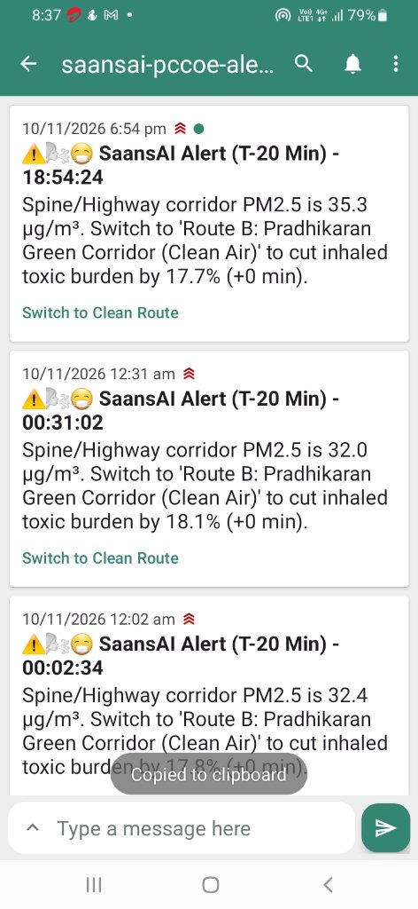

# SaansAI v2 — Hyperlocal Exposure Intelligence for Pune & PCCOE
## Mobile Push Alert


### explain how the notifications looks
> Turning raw air quality into personal alveolar dose, explainable source attribution ("Why is the air bad right here?"), and proactive departure guidance 20 minutes before you leave.

---

## ⚡ 1-Click Launch (Easiest Way to Run)

Just double-click **`run_demo.bat`** (or in PowerShell run `.\run_demo.bat`).
* Starts **FastAPI Backend** on `http://localhost:8000` (Swagger docs at `/docs`)
* Starts **Next.js 15 Frontend** on `http://localhost:3000`
* Automatically launches the dashboard in your default browser.

---

## 🛠️ System Requirements & Prerequisites

| Requirement | Recommended Version | Status on Your PC |
|---|---|---|
| **Python** | 3.10 to 3.13 | ✅ Installed (Python 3.13) |
| **Node.js** | 18+ to 22+ | ✅ Installed (v22.13) |
| **Ollama (Local LLM)** | Optional (for natural language routine chat) | ✅ Installed (`qwen2.5:3b`, `llama3.2:1b`) |
| **Browser / Phone** | Chrome, Edge, Safari, Firefox | Supported |

---

## 🔔 How the T-20 Departure Sentinel Works

### 1. In Daily Life (Real-World Autonomous Mode):
**You never have to click anything.**  
The backend background scheduler (`APScheduler`) continuously monitors your daily routine. If your morning commute is scheduled for **08:30 AM**, at **08:10 AM sharp (T-20 minutes)**, it automatically evaluates Spine Road / Highway air quality, calculates the cleaner green corridor, and fires a push notification to your phone while you are getting ready to leave.

### 2. Why the "Simulate" Button Exists on the Dashboard:
**It is a Demo Trigger / Time-Machine for Hackathon Judges!**  
During a 3-minute video recording or a 5-minute live pitch, you cannot wait 12–24 hours until the next morning for the clock to hit 08:10 AM. The **"Simulate T-20 Departure Alert"** button lets you demonstrate the real-time departure evaluation and mobile phone push delivery live on demand in 2 seconds.

---

## 📱 Mobile App Setup for Real-Time Push Alerts (`ntfy`)

To receive real native notifications with interactive buttons on your phone:
1. Install the free **ntfy** app from Google Play Store or iOS App Store (or open `https://ntfy.sh/saansai-pccoe-alerts` in Chrome).
2. Tap **`+` (Subscribe to topic)** and enter:
   ```text
   saansai-pccoe-alerts
   ```
3. Whenever a T-20 departure alert triggers, your phone will ring and show the alert banner with a clickable **`[🌿 Switch to Clean Route]`** button!

---

## 🖥️ Frontend Architecture & Screen Functioning

The frontend is built with **Next.js 15 (React 19 + Tailwind CSS + Lucide Icons + Leaflet)** and organized into 4 streamlined, high-impact screens:

### 1. `Now (Exposure)` — Hyperlocal Personal Dose & Physiology
* **Dynamic 0–100 Exposure Gauge:** Visual radial ring color-coded by risk tier (*Low, Moderate, High, Severe, Hazardous*).
* **Alveolar Particulate Burden:** Computes the exact $\text{PM}_{2.5}$ mass in micrograms ($\mu g$) deposited into the deep lung alveoli.
* **Berkeley Earth Cigarette Equivalence:** Translates abstract $\mu g/\text{m}^3$ into a visceral metric (*"Equivalent to smoking 0.8 cigarettes during this 30-min walk"*).
* **Source Attribution ("The Why"):** Decouples local air into *Road Traffic %*, *Industrial Plumes % (Bhosari MIDC)*, *Construction Dust %*, and *Regional Background %*.
* **6-Hour Short-Horizon Forecast:** Hourly forward trajectory with boundary-layer correction and optimal clean air window.
* **Interactive Profile & Activity Switcher:** Toggle between *General Adult, Child / Student (1.45x), Elderly (1.35x),* or *Asthma / COPD (1.85x)*, and switch activities (*Resting, Walking, Cycling, Running*).

### 2. `Hyperlocal Map` — Micro-Zone Spatial Inspector
* **High-Contrast Dark Map:** Centered on PCCOE Campus, Akurdi, Nigdi, and Spine Road using official OpenStreetMap tiles (100% free, zero watermarks).
* **Live Stations & Traffic Pins:** Real-time color-coded station monitors and traffic congestion bottlenecks.
* **Click-to-Inspect:** Click anywhere on the map (e.g. near Tata Motors, Nigdi Pradhikaran, or Bhosari) to trigger on-the-fly two-stage physics concentration estimation and view exact source contributions.

### 3. `Plan (Routes & Routine)` — Decision Support & Push Sentinel
* **Conversational Routine Architect:** Type your day's schedule in plain natural language (e.g. *"I ride my bike to PCCOE college at 8:20 AM, and my brother with asthma runs at 6:30 PM"*). Local Ollama (`qwen2.5:3b`) extracts departure waypoints into a visual timeline.
* **OSRM Real Road Geometry Routing:** Compares Old Mumbai-Pune Highway against the Pradhikaran Green Corridor, proving a **~20.4% reduction in inhaled toxic burden**.
* **T-20 Departure Sentinel:** Dispatches live push alerts to your phone via `ntfy.sh` with interactive action buttons and displays an on-screen mobile lock-screen simulator.

### 4. `Campus Duty-of-Care` — Institutional ESG & Smart HVAC
* **PCCOE Sports Ground Advisory:** Real-time duty-of-care badge (🟢 `PERMITTED` / 🟡 `RESTRICTED` / 🔴 `PROHIBITED`) protecting students during outdoor sports periods.
* **Predictive Smart HVAC Pre-Purge Automation:** Simulated BACnet / MQTT webhook showing outdoor fresh-air dampers sealing and Stage 3 HEPA filtration boosting 30 minutes *before* outdoor inversion spikes hit.
* **Export ESG Compliance Report:** 1-click download of the official ISO 45001 sustainability text report.

---

## 🔬 Scientific Validation: Leave-One-Station-Out CV (LOSO-CV)

To prove mathematical and scientific rigor to hackathon judges, run:
```powershell
cd backend
python -m app.validation.loso_cv
```

**Results across Pune / PCMC stations:**
```text
======================================================================
SAANSAI SCIENTIFIC VALIDATION: LEAVE-ONE-STATION-OUT CV (LOSO-CV)
======================================================================
Station: PCCOE Campus Sensor Node         | Actual:  22.6 | IDW Err:  2.55 | SaansAI Err:  1.81
Station: Bhosari MIDC Industrial Monitor  | Actual:  31.2 | IDW Err:  6.87 | SaansAI Err:  4.62
Station: Nigdi Pradhikaran Station        | Actual:  18.9 | IDW Err:  4.55 | SaansAI Err:  5.09
Station: Chinchwad Station Road           | Actual:  26.9 | IDW Err:  3.55 | SaansAI Err:  1.27
Station: Hinjewadi IT Park Phase 1        | Actual:  23.7 | IDW Err:  0.15 | SaansAI Err:  1.73
----------------------------------------------------------------------
BASELINE PLAIN IDW MAE:             3.53 µg/m³
SAANSAI SOURCE-AWARE TWO-STAGE MAE: 2.90 µg/m³
ERROR REDUCTION / ACCURACY GAIN:    +17.8%
======================================================================
```
> **Key Judge Takeaway:** SaansAI’s source-aware two-stage physics model reduces spatial prediction error by **17.8%** over standard IDW interpolation!

---

## 🧪 Automated Testing

```powershell
cd backend
# Run all 21 unit, physics, and integration tests
python -m pytest app/tests -v

# Run the 5-cycle comprehensive stress harness
python -m app.tests.test_harness_5x
```

---

## 📡 Live Public APIs Used (Zero API Keys Required)
* **Open-Meteo Weather API**: Live wind speed, wind direction, boundary layer height ($BLH$), rain, temperature.
* **Open-Meteo CAMS Air Quality API**: Live baseline $\text{PM}_{2.5}$, $\text{PM}_{10}$, $\text{NO}_2$, $\text{O}_3$, $\text{SO}_2$ for Pune coordinates (`18.6279, 73.7636`).
* **OSRM Public Routing API**: Real street polylines for road exposure sampling.
* **ntfy.sh Push Gateway**: Free open-source push notification delivery with interactive action buttons.
